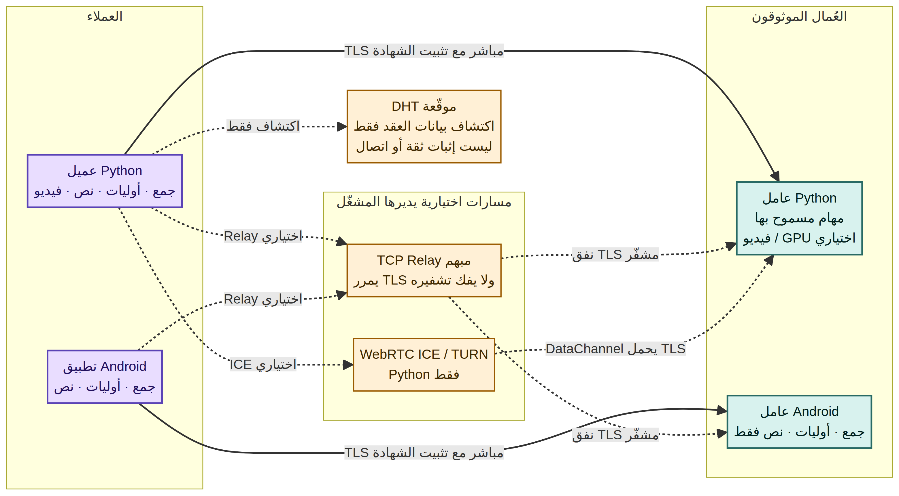

# RHEXORA

**Private, bounded computing across devices you trust.** RHEXORA is an open-source peer-compute prototype: Python and Android peers exchange allow-listed tasks over authenticated, certificate-pinned TLS.

[العربية](README_AR.md) · **Version 0.4.0a1 — Alpha** · Apache-2.0

[](https://github.com/ibra8y3-web/RHEXORA/actions/workflows/android.yml)
[](https://github.com/ibra8y3-web/RHEXORA/actions/workflows/tests.yml)
[](https://github.com/ibra8y3-web/RHEXORA/actions/workflows/security.yml)

> **Alpha notice:** This is not a production-ready 1.0 release. Do not use it for sensitive workloads or connect workers to strangers. Public-network, real-GPU, physical-Android-device and independent security-audit acceptance remain separate requirements.

## How it fits together



The diagram describes implemented paths, not hosted services: operators provide their own DHT seeds, signaling, TURN and Relay infrastructure. Discovery metadata is not task authorization; invites and pinned TLS identities establish trust.

## What works today

| Capability | Python peers | Android app / worker |
|---|---:|---:|
| Integer sum (`math.sum_ints`) | Yes | Yes |
| Prime counting (`math.count_primes`) | Yes | Yes, bounded range |
| Text statistics (`text.analyze`) | Yes | Yes |
| Distributed FFmpeg video transcoding | Yes | Not implemented |
| Direct TLS with certificate pinning | Yes | Yes |
| Opaque TCP Relay fallback | Yes, self-hosted | Yes, self-hosted |
| WebRTC ICE / TURN transport | Yes, optional | Not implemented |
| Signed UDP DHT discovery | Yes | Not implemented |
| Hardware video encoding | Python/FFmpeg only; requires a successful device encode probe | Not implemented |

Android runs as both a requester and an **opt-in foreground worker**. The worker only accepts the three bounded tasks listed above; it does not run arbitrary code, video jobs or GPU work. Its service is started and stopped by the device owner.

### Python video pipeline

Python workers can receive authorized video jobs, transcode separate segments through FFmpeg, return hash-verified files and assemble the result. This distributed pipeline may differ from a single-pass encode in timing, quality, metadata and compatibility. GPU use is reported only after a real hardware encode probe; a listed encoder alone does not prove a working GPU.

## Quick start

```bash
python -m pip install -e '.[test]'
python -m pytest -q
rhexora --help
```

Start a local worker:

```bash
rhexora init --data-dir ./worker --port 47821
rhexora run --data-dir ./worker
```

In another terminal, create an invite for an address reachable by the requester:

```bash
rhexora invite --data-dir ./worker --host <reachable-host> --output ./worker.invite.json
```

Transfer that file only to the intended trusted requester. Invites are bearer credentials—never commit or post them.

## Android app

The native Kotlin/Jetpack Compose app lives in [`android/`](android/). It supports importing a JSON invite, running the three Android-supported tasks, and explicitly starting a foreground worker. Build requirements and details are in [`android/README.md`](android/README.md). Android ICE, video/FFmpeg and GPU processing are not implemented. The release APK is unsigned; real-device, battery-policy and OEM validation are still required.

## Network deployment and verification

- [Architecture and protocol](docs/ARCHITECTURE.md) · [protocol details](docs/PROTOCOL.md)
- [NAT, ICE and Relay](docs/NAT.md) · [ICE setup](docs/ICE.md) · [Relay operations](ops_README_RELAY.md)
- [DHT deployment](docs/GLOBAL_DHT.md) · [public network acceptance prerequisites](docs/PUBLIC_NETWORK_ACCEPTANCE.md)
- [GPU acceptance](docs/GPU.md) · [video processing](docs/VIDEO.md)
- [GitHub Actions guide (Arabic)](GITHUB_CI_GUIDE_AR.md)

The **Public network smoke tests** workflow needs operator-owned endpoints, credentials and a live worker. The **Real GPU video acceptance** workflow is manual and needs a registered self-hosted Linux runner labelled `rhexora-gpu` with a supported GPU, driver and FFmpeg build. A green workflow is evidence only for the infrastructure and hardware that actually ran it.

## Security and limitations

- TLS certificate pinning, per-node invite tokens, bounded allow-listed handlers, request/result hashes and basic resource limits are implemented.
- Hashes provide byte integrity, not proof that a worker computed an answer honestly. There is no general consensus or verifiable-computation layer.
- DHT records are signed discovery hints, not proof of reachability or trust. Relay, signaling, DHT and TURN operators can observe metadata and deny service.
- **No independent security audit, public-network certification or production-scale load test has been completed.** See [`SECURITY_AUDIT_REQUEST.md`](SECURITY_AUDIT_REQUEST.md).
- Hardware and physical-device claims require acceptance on the actual target machine. Current project status and remaining checks: [`IMPLEMENTATION_STATUS.md`](IMPLEMENTATION_STATUS.md).

## Contributing and license

See [`CONTRIBUTING.md`](CONTRIBUTING.md) for contribution guidance. Licensed under [Apache-2.0](LICENSE).

For CI diagnostics, see [GitHub Actions failure bundles](GITHUB_CI_GUIDE_AR.md#تقارير-الفشل-الكاملة).
