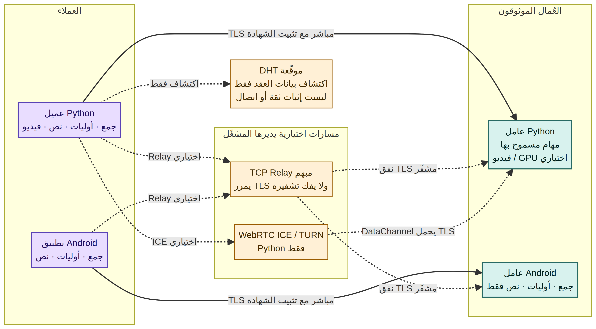

# RHEXORA — ريكسورا

**حوسبة خاصة بين أجهزة تثق بها.** مشروع مفتوح المصدر لتبادل مهام محدودة ومسموح بها بين عُقد Python وتطبيق Android عبر TLS موثّق مع تثبيت بصمة شهادة العامل.

**العربية** · [English](README.md) · **الإصدار 0.4.0a1 — ألفا** · Apache-2.0

[](https://github.com/ibra8y3-web/RHEXORA/actions/workflows/android.yml)
[](https://github.com/ibra8y3-web/RHEXORA/actions/workflows/tests.yml)
[](https://github.com/ibra8y3-web/RHEXORA/actions/workflows/security.yml)

> **تنبيه ألفا:** هذا ليس إصدارًا إنتاجيًا مستقرًا 1.0. لا تستخدمه للبيانات الحساسة، ولا توصل عاملًا بأشخاص لا تثق بهم. قبول الشبكة العامة وGPU وأجهزة Android الحقيقية والتدقيق الأمني المستقل ما زالت متطلبات منفصلة.

## كيف تعمل الشبكة؟



المخطط يشرح مسارات موجودة في الكود، وليس خدمات مستضافة: على المشغّلين إعداد عقد DHT وsignaling وTURN وRelay الخاصة بهم. بيانات الاكتشاف لا تمنح صلاحية تنفيذ مهمة؛ الثقة تعتمد على الدعوات الخاصة وهويات TLS المثبتة.

## ما الذي يعمل الآن؟

| الميزة | عُقد Python | تطبيق وعامل Android |
|---|---:|---:|
| جمع الأعداد (`math.sum_ints`) | نعم | نعم |
| عدّ الأعداد الأولية (`math.count_primes`) | نعم | نعم، ضمن نطاق محدود |
| إحصاءات النص (`text.analyze`) | نعم | نعم |
| معالجة فيديو موزعة عبر FFmpeg | نعم | غير منفذة |
| TLS مباشر مع تثبيت بصمة الشهادة | نعم | نعم |
| مسار TCP Relay مبهم | نعم، باستضافة ذاتية | نعم، باستضافة ذاتية |
| WebRTC ICE / TURN | نعم، اختياري | غير منفذ |
| اكتشاف DHT عبر UDP موقّع | نعم | غير منفذ |
| ترميز فيديو بمسرّع عتادي | Python/FFmpeg فقط، ويتطلب نجاح ترميز فعلي على الجهاز | غير منفذ |

يعمل تطبيق Android كطالب مهام وكعامل **اختياري يبدأه المستخدم يدويًا** في خدمة أمامية ظاهرة. العامل يقبل المهام الثلاث المحددة أعلاه فقط؛ لا ينفذ كودًا حرًا ولا مهام فيديو أو GPU.

### معالجة الفيديو عبر Python

يمكن لعُمال Python استقبال مهمة فيديو مصرح بها، وترميز مقاطع منفصلة باستخدام FFmpeg، وإرجاع ملفات يتم التحقق منها عبر SHA-256 ثم تجميعها. قد تختلف النتيجة عن الترميز المتصل في التوقيت والجودة والبيانات الوصفية والتوافق. لا يُعلن عن ترميز GPU لمجرد ظهور اسم encoder؛ يجب أن ينجح اختبار ترميز عتادي فعلي.

## تجربة سريعة

```bash
python -m pip install -e '.[test]'
python -m pytest -q
rhexora --help
```

تشغيل عامل محلي:

```bash
rhexora init --data-dir ./worker --port 47821
rhexora run --data-dir ./worker
```

في نافذة طرفية أخرى، أنشئ دعوة إلى عنوان يستطيع طالب المهام الوصول إليه:

```bash
rhexora invite --data-dir ./worker --host <reachable-host> --output ./worker.invite.json
```

انقل الملف فقط إلى طالب المهام الموثوق. الدعوة تحمل بيانات اعتماد؛ لا ترفعها إلى GitHub ولا تنشرها.

## تطبيق Android

التطبيق الأصلي Kotlin وJetpack Compose موجود في [`android/`](android/). يدعم استيراد دعوة JSON، وتشغيل المهام الثلاث المدرجة، وبدء عامل ظاهر بإذن المستخدم. تفاصيل البناء في [`android/README.md`](android/README.md). لا يدعم Android حاليًا ICE أو الفيديو/FFmpeg أو GPU. ملف APK للإصدار غير موقّع؛ ويلزم اختباره على أجهزة حقيقية وسياسات البطارية ومصنّعي الأجهزة المختلفين.

## الشبكات والتحقق

- [المعمارية والبروتوكول](docs/ARCHITECTURE.md) · [تفاصيل البروتوكول](docs/PROTOCOL.md)
- [NAT وICE وRelay](docs/NAT.md) · [إعداد ICE](docs/ICE.md) · [تشغيل Relay](ops_README_RELAY.md)
- [نشر DHT](docs/GLOBAL_DHT.md) · [متطلبات اختبار الشبكة العامة](docs/PUBLIC_NETWORK_ACCEPTANCE.md)
- [قبول GPU](docs/GPU.md) · [معالجة الفيديو](docs/VIDEO.md)
- [دليل GitHub Actions](GITHUB_CI_GUIDE_AR.md)

يحتاج **Public network smoke tests** إلى عناوين وخدمات وبيانات اعتماد يملكها المشغّل، وإلى عامل متصل. أما **Real GPU video acceptance** فيعمل يدويًا ويتطلب GitHub self-hosted runner بنظام Linux يحمل الوسم `rhexora-gpu` ومجهزًا بـGPU وتعريف وFFmpeg مناسب. نجاح الاختبار يثبت فقط ما تم تشغيله فعليًا على تلك البنية.

## الأمان والحدود

- يتضمن المشروع تثبيت شهادة TLS، ورموز دعوات لكل عقدة، ومعالجات مهام محدودة ومسموحًا بها، وبصمات للطلب والنتيجة، وحدودًا أساسية للموارد.
- بصمة النتيجة تثبت سلامة البايتات لا صحة الحساب؛ لا توجد آلية عامة للإجماع أو التحقق من صحة الحوسبة.
- سجلات DHT تلميحات اكتشاف موقعة وليست إثباتًا للاتصال أو الثقة. يستطيع مشغّلو Relay وsignaling وDHT وTURN مشاهدة بيانات وصفية أو تعطيل الخدمة.
- **لم يُجرَ تدقيق أمني مستقل أو اعتماد للشبكة العامة أو اختبار تحميل إنتاجي واسع.** راجع [`SECURITY_AUDIT_REQUEST.md`](SECURITY_AUDIT_REQUEST.md).
- إثبات دعم العتاد أو الهاتف يحتاج اختبار قبول على الجهاز المستهدف نفسه. الحالة والمهام المتبقية في [`IMPLEMENTATION_STATUS.md`](IMPLEMENTATION_STATUS.md).

## المساهمة والترخيص

راجع [`CONTRIBUTING.md`](CONTRIBUTING.md) للمساهمة. المشروع مرخص بموجب [Apache-2.0](LICENSE).

لتشخيص أعطال GitHub Actions، راجع [حزم سجلات الفشل](GITHUB_CI_GUIDE_AR.md#تقارير-الفشل-الكاملة).
